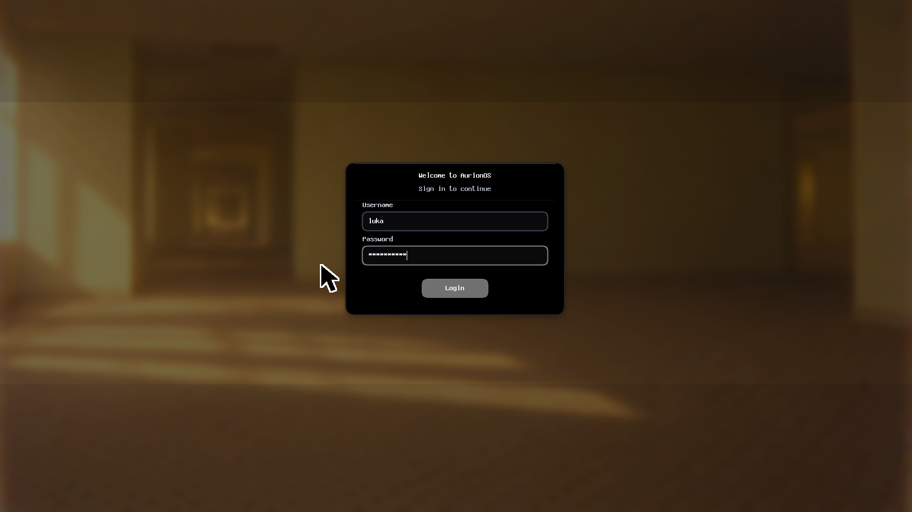
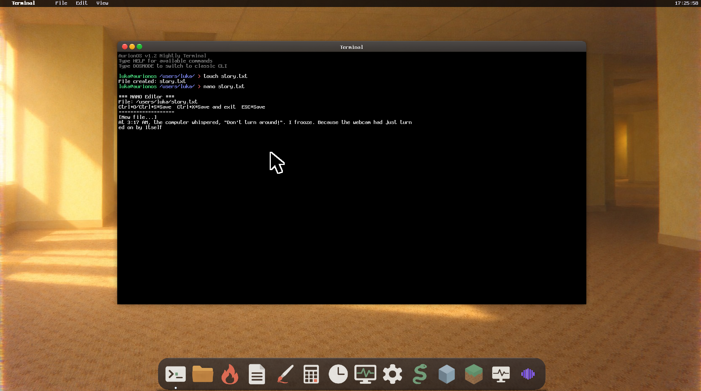
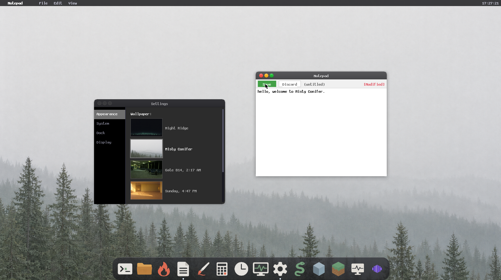
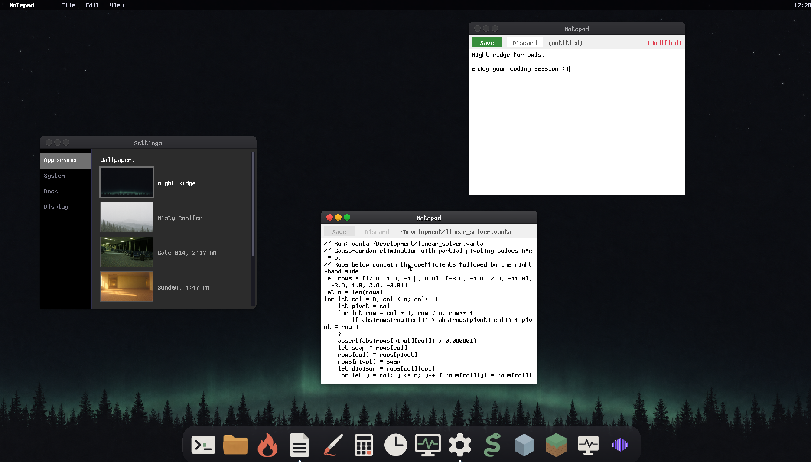
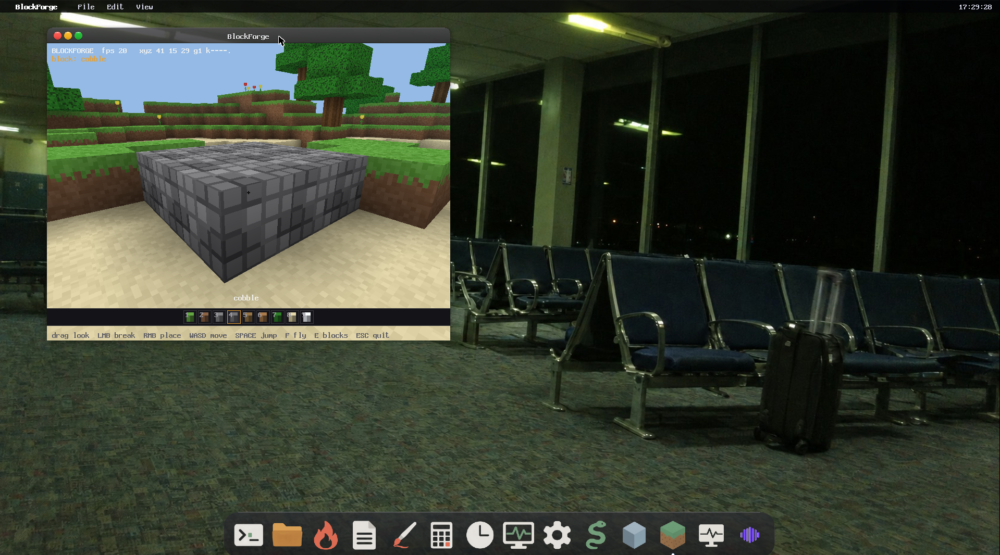
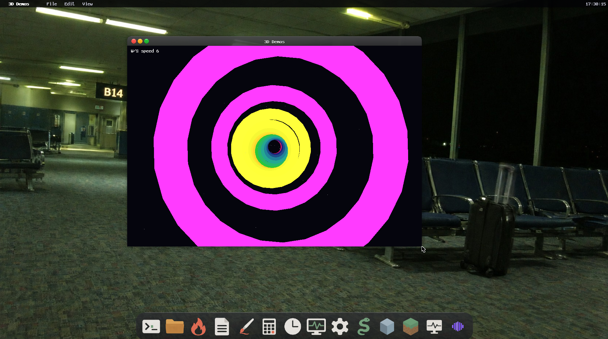

<div align="center">

# AURION OS

### A Modern Operating System Built From Scratch

**Pure Speed. Zero Compromise. 1.2 Nightly**

[Features](#features) • [Screenshots](#screenshots) • [Quick Start](#quick-start) • [Building](#building) • [Documentation](#documentation)

---

</div>

## What is AurionOS?

AurionOS is a complete operating system written from the ground up in x86 assembly and C. No Linux kernel. No POSIX. No borrowed code. Every line - from the bootloader to the desktop environment - was built to prove that modern, usable operating systems can still be created by individuals who care about understanding how computers actually work.

This is not a toy. This is a statement that software can be fast, beautiful, and uncompromising.

### The Vision

Operating systems have become bloated, opaque, and inaccessible. AurionOS rejects that trend. It is:

- **Fast** - Boots in seconds, responds instantly, wastes nothing
- **Transparent** - Every component is readable, understandable, modifiable
- **Complete** - GUI, audio, filesystem, applications - everything you need
- **Real** - Runs on actual hardware, not just emulators

---

## Features

### Desktop Environment

- Modern windowed GUI with macOS-style menu bar and dock
- Drag-and-drop window management with minimize, maximize, restore
- Multiple resolution support (1280×720 to 2560×1440)
- Desktop icons with file operations and rubber-band selection
- Smooth mouse cursor with acceleration and size settings (Small / Large / XLarge)
- Login screen with blurred desktop background
- Boot screen with CRT power-on sweep animation
- 4 PNG wallpapers: Night Ridge, Misty Conifer, Gate B14 2:17 AM, Sunday 4:47 PM
- Settings app with live wallpaper preview thumbnails, dock magnification toggle, transparency toggle, resolution picker, cursor size selector
- Global clipboard shared across Terminal, Notepad, and menu bar (Ctrl+C / Ctrl+V)
- Terminal scrollback buffer - PgUp / PgDn to browse history
- macOS-style dock with hover magnification and running-app indicators
- macOS-style menu bar with File / Edit / View menus and keyboard shortcuts

### Applications

**Blaze Browser**
- Custom HTML/CSS/JavaScript engine
- Bookmark management
- Tab browsing
- Local file viewing (`file://` and `/Documents/` paths)
- Developer console (F12)
- Offline-only - network drivers removed in this build

**Productivity**
- Terminal with full command-line interface and scrollback
- Notepad text editor with Save / Discard / Save-As dialog
- File Manager with directory navigation
- Calculator (standard and scientific)
- System Information viewer
- Task Manager - live process table, CPU %, memory, per-process heap accounting
- Audio Manager - WAV playback via Sound Blaster 16, volume control, playlist

**Graphics**
- Paint application with drawing tools
- Color picker and palette
- Pixel-perfect rendering
- 3D Demo - 6 real-time demos (rotating shapes, solar system, tunnel, particles, torus knot, cube collector)

**Games**
- Snake with scoring and speed levels
- BlockForge - voxel building game with mining, building, inventory, particles, clouds, fog, and 9 placeable block types

### System Features

**Dual Mode Operation**
- GUI Mode - Full desktop environment
- DOS Mode - Classic command-line interface
- Switch between modes with `DOSMODE` / `GUIMODE` commands

**Storage**
- Custom AurionFS filesystem with persistence
- ISO 9660 CD-ROM support (read-only)
- FAT32 support (experimental)
- File and directory operations
- Configuration storage
- Application data management

**Audio**
- Sound Blaster 16 ISA driver (DSP, DMA, mixer, IRQ)
- PCM audio engine with chunked DMA playback
- WAV file playback (8-bit and 16-bit, mono and stereo)
- System beeps and boot/shutdown jingles via PC speaker
- Audio Manager app with volume slider and track list

**Security**
- PBKDF2-HMAC-SHA256 password hashing (replaces legacy djb2)
- ChaCha20-based CSPRNG seeded from RDRAND/RDSEED + TSC jitter
- Overflow-checked safe arithmetic (`safe_mul_u32`, `safe_add_u32`)
- User pointer validation at syscall boundary
- Fail-closed authentication - no default credentials, no bypass paths

**Multi-Core (SMP)**
- APIC-based multi-core boot with AP trampoline
- Parallel rendering in AurionGL (scanline band distribution)
- Parallel `aglClear` across cores
- Graceful fallback to single-core when no APIC present

**Kernel Panic Subsystem v2**
- Linux-style oops screen with live CPU state (CR0/CR2/CR3, EFLAGS, TSC, CPUID)
- Real EBP-chain backtrace with sanity gates
- Live heap stats, VRAM probe, VBE boot block read
- Dual renderer: VGA text + VESA graphics + COM1 serial journal
- Machine-parseable `PANIC:` one-liner for CI boot checks
- Panic journal ring buffer (last 8 oops) with checksum verification
- POST codes to port 0x80, keyboard LED blink codes
- Interactive halt loop: ENTER=reboot, S=serial replay, D=re-dump, H=help, P=poweroff, X=hex export

### Developer Tools

- **Vanta** - complete scripting language with heap, backtrace, panic, and 8 shipped examples
  - `hello.vanta`, `collections.vanta`, `linear_solver.vanta`, `mandelbrot.vanta`, `merge_sort.vanta`, `pathfinding.vanta`, `scheduler.vanta`, `tour.vanta`
- Make build system (`MAKE` command)
- GREP text search
- VANTA command to run `.vanta` scripts from the shell

### 3D Graphics

**AurionGL 2.1** - OpenGL-inspired software rasterizer (finally fully working!)
- Software rasterization with z-buffering
- Perspective-correct texture mapping with affine subdivision
- Lighting system (up to 4 lights, Blinn-Phong)
- Matrix transformation stack (modelview / projection / texture)
- Immediate mode rendering (`aglBegin` / `aglVertex3f` / `aglEnd`)
- SMP parallel scanline band rendering
- Fixed-point 16.16 texel addressing with integer stepping
- Incremental face cache with dirty-region rebuild
- 4 specialized span kernels (untextured / nearest / bilinear / generic)
- Fog (linear, EXP, EXP2), alpha blending, backface culling
- Quake III fast inverse sqrt, Cody-Waite trig, binary exponentiation

---

## Screenshots

*AurionGL finally works! Check out the new renders.*

### Login Screen


### Writing Story in Terminal


### Misty Confie


### Night Ridge for Owls


### BlockCraft for Gamers


### 3d DEMOS


---

## Quick Start

### Running in QEMU

```bash
# Linux/macOS
qemu-system-i386 -cdrom build/aurionos.iso -boot d -m 512M -smp 4

# Windows (PowerShell)
qemu-system-i386 -cdrom build\aurionos.iso -boot d -m 512M -smp 4

# Via Make
make run
```

### Running in VMware (recommended)

1. Create new VM: "Other" → "Other (32-bit)"
2. Add CD-ROM: Point to `build/aurionos.iso`
3. Add Hard Disk: Point to `build/aurionos_hdd.img` (for persistence)
4. Set firmware to BIOS (not UEFI)
5. Boot from CD-ROM first time, then from HDD

### Running in VirtualBox

1. Create new VM: Type "Other", Version "Other/Unknown (32-bit)"
2. Storage: Add `build/aurionos.iso` as optical drive
3. Storage: Add `build/aurionos_hdd.img` as hard disk (for persistence)
4. System: Enable I/O APIC
5. Boot order: Optical first, then Hard Disk

### First Boot

1. System boots to installer
2. Follow setup wizard:
   - Select applications to install
   - Choose keyboard layout (English / Serbian Latin)
   - Set root password (PBKDF2-hashed)
3. Click "Install"
4. After installation, click "Reboot"
5. System boots to login screen → desktop

### Switching Modes

- GUI → DOS: Open Terminal, type `DOSMODE`
- DOS → GUI: Type `GUIMODE` at prompt

---

## Building from Source

### Prerequisites

**Linux/macOS:**

```bash
# Ubuntu/Debian
sudo apt install build-essential nasm qemu-system-x86 xorriso

# Arch Linux
sudo pacman -S base-devel nasm qemu xorriso

# macOS
brew install nasm qemu xorriso
brew install i686-elf-gcc  # Cross-compiler
```

**Windows:**

```bash
# Install WSL2 (Ubuntu)
wsl --install

# Inside WSL - Install 32-bit development libraries (REQUIRED for building)
sudo dpkg --add-architecture i386
sudo apt update
sudo apt install libc6-dev-i386 gcc-multilib g++-multilib build-essential nasm qemu-system-x86 xorriso
```

### Build Commands

```bash
# Clone repository
git clone https://github.com/Luka12-dev/AurionOS.git
cd AurionOS

# Build everything (Linux/macOS)
make all

# Build everything (Windows)
wsl make all
```

### Build Output

| File | Description |
|---|---|
| `build/kernel.bin` | Kernel binary |
| `build/bootload.bin` | Bootloader (512 bytes) |
| `build/stage2.bin` | Stage 2 loader (BIOS services) |
| `build/aurionos.img` | Floppy image |
| `build/aurionos.iso` | Bootable ISO (El Torito floppy emulation) |
| `build/aurionos_hdd.img` | Hard disk image with persistence |

### Build System Explained

The Makefile orchestrates the entire build:

1. **Stage 2** (`src/asm/stage2.asm`) - NASM assembles real-mode BIOS services (VESA probe, RAM detect)
2. **Bootloader** (`src/asm/bootload.asm`) - NASM assembles to 512-byte boot sector, patched with stage2/kernel sizes by `tools/build_bootloader.py`
3. **Kernel** (`src/**/*.asm`, `src/**/*.c`, `AurionGL/auriongl.c`) - GCC compiles C, NASM assembles ASM, links to flat binary
4. **Wallpapers** - PNG files embedded into HDD image at fixed LBA slots by `tools/embed_wallpaper.py`
5. **Icons** - PNG files embedded into HDD image at fixed LBA slots by `tools/embed_icons.py`
6. **Images** - Python scripts create floppy, ISO, and HDD images

The build is deterministic - same source always produces same binary.

---

## Architecture

### Boot Process

```
BIOS → Bootloader (512 bytes, LBA 0)
  ↓
Load Stage 2 (LBA 1.., real-mode BIOS services)
  ↓
Load Kernel via bounce buffer → 1MB
  ↓
Switch to Protected Mode (32-bit)
  ↓
Initialize: IDT, PIC, Memory, Drivers, SMP
  ↓
Check boot_mode_flag
  ↓
├─ GUI Mode: VESA graphics → Boot screen → Login → Desktop
└─ DOS Mode: VGA text → Shell
```

### Memory Layout

```
0x00000000 - 0x000003FF : Real Mode IVT
0x00000400 - 0x000004FF : BIOS Data Area
0x00000500 - 0x00007BFF : Free (bootloader stack)
0x00007C00 - 0x00007DFF : Bootloader (512 bytes)
0x00007E00 - 0x00008FFF : Stage 2 loader
0x00009000 - 0x0000901F : VBE boot info block
0x00009010 - 0x00009013 : BIOS RAM total (KB, INT15/E801)
0x00010000 - 0x0006FFFF : Kernel (loaded here)
0x00070000 - 0x0009FFFF : Free
0x000A0000 - 0x000BFFFF : VGA memory
0x000C0000 - 0x000FFFFF : BIOS ROM
0x00100000+             : Extended memory (heap)
```

### Component Structure

```
AurionOS/
 ├── src/
 │   ├── asm/
 │   │   ├── bootload.asm       # Bootloader (512 bytes)
 │   │   ├── stage2.asm         # Stage 2: BIOS services, VESA probe
 │   │   ├── kernel.asm         # Kernel entry
 │   │   ├── memory.asm         # Memory management
 │   │   ├── filesys.asm        # Filesystem primitives
 │   │   ├── io.asm             # VGA text I/O
 │   │   ├── interrupt.asm      # IDT and ISRs
 │   │   ├── vesa.asm           # VESA mode setup
 │   │   ├── smp_low.asm        # SMP low-level (AP boot)
 │   │   └── smp_tramp16.asm    # AP trampoline (16-bit)
 │   ├── core/
 │   │   ├── commands.c         # Shell command dispatcher
 │   │   ├── shell.c            # DOS mode shell
 │   │   ├── scheduler.c        # Process table, CPU/mem accounting
 │   │   ├── smp.c              # SMP detection, APIC boot, band jobs
 │   │   ├── clipboard.c        # Global clipboard
 │   │   ├── pci.c              # PCI bus enumeration
 │   │   ├── syscall.c          # System call interface
 │   │   ├── installer.c        # Setup wizard
 │   │   └── utils.c            # String helpers
 │   ├── gui/
 │   │   ├── desktop.c          # Desktop environment
 │   │   ├── window_manager.c   # Window manager, dock, settings
 │   │   ├── menu_bar.c         # macOS-style menu bar
 │   │   ├── login_screen.c     # Login with blurred background
 │   │   ├── boot_screen.c      # CRT boot animation
 │   │   ├── terminal.c         # Terminal app with scrollback
 │   │   ├── scrollback.c       # Terminal scrollback buffer
 │   │   ├── icon_loader.c      # PNG icon loader from HDD
 │   │   └── gui_apps.c         # GUI application launchers
 │   ├── apps/
 │   │   ├── Blaze/             # Browser engine (7 files)
 │   │   ├── BlockForge.c       # Voxel building game
 │   │   ├── app_3d_demo.c      # 3D demo (6 demos)
 │   │   ├── app_task_manager.c # Task Manager
 │   │   └── cmd_make.c         # MAKE command
 │   ├── coding/
 │   │   ├── vanta.c            # Vanta scripting language
 │   │   ├── vanta.h
 │   │   ├── vanta_examples.c   # 8 shipped examples
 │   │   └── examples/          # .vanta source files
 │   ├── drivers/
 │   │   ├── ata.c              # ATA/IDE disk driver
 │   │   ├── mouse.c            # PS/2, USB, VMware, VBox, QEMU mouse
 │   │   ├── png.c              # Full PNG decoder
 │   │   ├── sb16.c             # Sound Blaster 16
 │   │   ├── sb16_stream.c      # SB16 DMA streaming
 │   │   ├── pcm_engine.c       # PCM audio engine
 │   │   ├── vmware_svga.c      # VMware SVGA II driver
 │   │   ├── vbe_graphics.c     # VBE framebuffer graphics
 │   │   ├── vga_fallback.c     # VGA text mode fallback
 │   │   └── icons.c            # Icon drawing (fallback)
 │   ├── fs/
 │   │   ├── fat32.c            # FAT32 (experimental)
 │   │   ├── iso9660.c          # ISO 9660 CD-ROM
 │   │   ├── fs_usage.c         # Disk usage reporting
 │   │   └── fs_maintenance.c   # FS repair, reset
 │   ├── crypto/
 │   │   └── security.c         # PBKDF2, CSPRNG, safe math
 │   └── kernel_panic/          # Panic subsystem v2 (10 files)
 ├── AurionGL/
 │   ├── auriongl.c             # AurionGL 2.1 rasterizer
 │   └── auriongl.h
 ├── include/                   # Header files
 ├── Wallpaper/                 # PNG wallpapers (1920×1080)
 ├── icons/                     # PNG dock icons (128×128)
 ├── tools/                     # Build scripts
 └── build/                     # Output directory
```

---

## Command Reference

### System

| Command | Description |
|---|---|
| `HELP` | Show available commands |
| `VER` | Display version |
| `CLS` / `CLEAR` | Clear screen |
| `GUIMODE` | Switch to GUI |
| `DOSMODE` | Switch to DOS mode |
| `REBOOT` | Restart system |
| `SHUTDOWN` | Shutdown system |
| `PAUSE` | Wait for keypress |
| `SLEEP <sec>` | Sleep for N seconds |
| `EXIT` | Exit shell |
| `COLOR <n>` | Set text color |
| `ASCII` | Show ASCII table |
| `HEXDUMP <addr>` | Hex dump memory |

### Info

| Command | Description |
|---|---|
| `TIME` | Show current time |
| `DATE` | Show current date |
| `UPTIME` | Show system uptime |
| `MEM` | Show memory stats |
| `SYSINFO` | Show system information |
| `CALC <expr>` | Evaluate arithmetic expression |

### Files

| Command | Description |
|---|---|
| `DIR` / `LS` | List directory |
| `CD <dir>` | Change directory |
| `MKDIR <name>` | Create directory |
| `RMDIR <name>` | Remove directory |
| `TOUCH <file>` | Create empty file |
| `DEL <file>` / `RM <file>` | Delete file |
| `CAT <file>` / `TYPE <file>` | Display file contents |
| `NANO <file>` | Edit file |
| `COPY <src> <dst>` | Copy file |
| `MOVE <src> <dst>` | Move file |
| `REN <old> <new>` | Rename file |
| `FIND <pattern>` | Find files |
| `TREE` | Show directory tree |
| `ATTRIB` | Show file attributes |
| `CHMOD <mode> <file>` | Change file mode |
| `GREP <pattern> <file>` | Search text in file |

### Disk

| Command | Description |
|---|---|
| `VOL` | Show volume info |
| `LABEL <name>` | Set volume label |
| `CHKDSK` | Check disk |
| `FORMAT CONFIRM` | Format disk |
| `DISKPART` | Show partition info |
| `FSCK` | Filesystem check |

### User Management

| Command | Description |
|---|---|
| `USERADD <user> <pass>` | Add user |
| `USERDEL <user>` | Delete user |
| `PASSWD` | Change password |
| `USERS` | List users |
| `LOGIN <user> <pass>` | Login as user |
| `LOGOUT` | Logout |
| `SU <user> <pass>` | Switch user |
| `SUDO <command>` | Run command as root |

### Processes

| Command | Description |
|---|---|
| `PS` | List processes |
| `KILL <pid>` | Kill process |
| `TOP` | Live process monitor |
| `TASKLIST` | List tasks |
| `TASKKILL <pid>` | Kill task |

### Developer

| Command | Description |
|---|---|
| `VANTA <file.vanta>` | Run Vanta script |
| `MAKE` | Run build system |
| `KEYBOARD <lang>` | Set keyboard layout (ENGLISH / SERBIAN) |

---

## Hardware Compatibility

### Tested Platforms

| Platform | Status | Notes |
|---|---|---|
| QEMU | Full Support | Recommended for development |
| VMware Workstation | Full Support | SVGA acceleration works |
| VirtualBox | Full Support | Guest absolute mouse works |
| Real Hardware (PS/2) | Full Support | Tested on one PC |
| Real Hardware (USB) | Partial | Depends on controller |

### Graphics

- VESA VBE - Primary graphics mode
- Bochs VBE - Emulator-specific extensions
- VMware SVGA II - Hardware acceleration in VMware
- VGA Text Mode - 80×25 for DOS mode

### Input Devices

- PS/2 Keyboard - Full support
- PS/2 Mouse - Full support with IntelliMouse/Explorer wheel
- USB Mouse - UHCI, OHCI, EHCI, xHCI
- VMware VMMouse - Absolute positioning
- VirtualBox Guest Mouse - Absolute positioning
- QEMU/KVM USB Tablet - Absolute positioning

### Audio

- Sound Blaster 16 - Full support (DSP, DMA, mixer, IRQ5)
- PC Speaker - Beeps and jingles

---

## Development

### Project Structure

The codebase is organized by function:

- **Boot** - Bootloader, stage 2, AP trampoline
- **Kernel** - Core system services, scheduler, SMP
- **Drivers** - Hardware abstraction (ATA, mouse, audio, GPU)
- **GUI** - Desktop, window manager, menu bar, dock, login, boot screen
- **Apps** - User applications (Blaze, BlockForge, 3D Demo, Task Manager, Audio Manager)
- **Filesystem** - AurionFS, FAT32, ISO 9660
- **Crypto** - PBKDF2, CSPRNG, safe arithmetic
- **Coding** - Vanta scripting language and examples
- **Kernel Panic** - Panic subsystem v2 (10 files)
- **Tools** - Build scripts (`build_bootloader.py`, `mkfloppy.py`, `mkiso.py`, `embed_wallpaper.py`, `embed_icons.py`, `prepare_png_assets.py`)

### Coding Standards

- Assembly: NASM syntax, Intel style
- C: C11 standard, freestanding
- No standard library - everything custom
- Comments explain WHY, not WHAT
- Consistent naming: `snake_case` for functions, `PascalCase` for types

### Adding Applications

1. Create app in `src/gui/gui_apps.c`
2. Add icon PNG to `icons/`
3. Register in desktop app list
4. Add icon to `tools/embed_icons.py` ICONS list
5. Rebuild with `make`

---

## Troubleshooting

### Build Issues

**"nasm: command not found"**

```bash
# Install NASM assembler
sudo apt install nasm  # Ubuntu/Debian
```

**"i686-elf-gcc: command not found"**

```bash
# Use system GCC with -m32 flag (already configured in Makefile)
sudo apt install gcc-multilib
```

**"Make fails on Windows"**

```bash
# Always use WSL
wsl make
```

### Runtime Issues

**Black screen on boot**

- Try different resolution in VM settings
- Ensure BIOS mode (not UEFI)
- Check that ISO/HDD are properly attached

**Mouse not working**

- Enable USB controller in VM
- Try PS/2 mouse instead
- Check mouse integration settings

**Audio not working**

- Ensure Sound Blaster 16 is enabled in VM settings
- Check IRQ5 is not shared with another device
- Run `SNDTEST` in DOS mode to diagnose

**Keyboard layout wrong**

- Run installer and select correct layout
- Or use `KEYBOARD ENGLISH` / `KEYBOARD SERBIAN` in DOS mode

---

## Performance

### Boot Time

- Cold boot to desktop: ~3-5 seconds (QEMU)
- Mode switch (GUI ↔ DOS): ~1 second

### Memory Usage

- Minimum RAM: 64 MB
- Recommended RAM: 128 MB

### Disk Usage

- ISO image: ~46 MB (due to higher quality icons and wallpapers)
- HDD image: 60 MB (configurable via `HDD_SIZE_MB`)
- With user data: Varies

---

## License

See [LICENSE](LICENSE) file for details.

---

## Credits

Built by a developer who believes operating systems should be understandable, not mysterious black boxes.

Special thanks to:

- OSDev community for documentation
- NASM and GCC teams for excellent tools
- Everyone who said "you can't build an OS alone" - you were wrong
- **mage7968** ([GitHub](https://github.com/William43243)) - thanks for helping patch many security issues. Run `mage7968` in AurionOS terminal for more.

---

## Links

- Changelog: See [CHANGELOG.md](CHANGELOG.md) for version history
- Issues: [Issues](https://github.com/Luka12-dev/AurionOS/issues)

<div align="center">

**AurionOS 1.2 Nightly**

Built with passion. Runs with purpose.

</div>